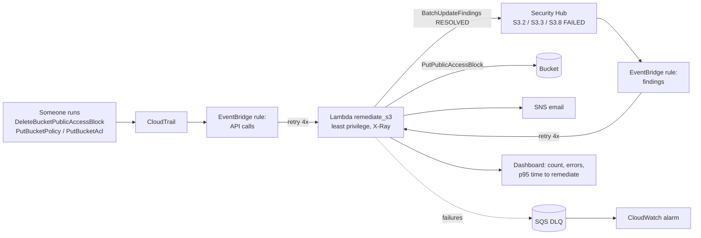

# AWS Auto-Remediation: Public S3 Buckets


When someone removes a bucket's public access block, or Security Hub flags a bucket as public, an EventBridge rule triggers a Lambda that re-applies the block, resolves the finding, and emails the team, usually within about a minute. Built with Terraform, least-privilege IAM, a dead-letter queue, alarms and a CloudWatch dashboard.

**Problem:** a public S3 bucket can leak data within minutes; a ticket-driven fix takes hours. **Outcome:** detection to fix in about a minute, every action logged, with a tagged exception path so the business is not blocked.

## Architecture



## Behavior

| Case | Result |
| --- | --- |
| Public access block removed, or bucket policy/ACL changed | Block re-applied, email sent |
| Security Hub S3.2, S3.3 or S3.8 finding, status FAILED | Block re-applied, finding marked RESOLVED with a note, email sent |
| Bucket tagged `public-allowed=true` | Skipped and logged (documented exception) |
| `DRY_RUN=true` | Logs and emails what it would fix, changes nothing |
| Any other event | Ignored |

## Deploy

Requires a CloudTrail trail (EventBridge only receives these API events when one is logging), for example from [aws-secure-landing-zone](https://github.com/mk7git-hub/aws-secure-landing-zone).

```bash
pip install boto3 pytest && pytest -q            # 8 tests, AWS calls stubbed with botocore Stubber
cd infra && cp terraform.tfvars.example terraform.tfvars   # owner, alert_email
terraform init && terraform apply
cd .. && ./demo.sh                                # creates a bucket, opens it, watches it get closed
```

Confirm the SNS subscription email. Dashboard link: `terraform output dashboard_url`.

## Cost

Effectively free at lab volume: Lambda and EventBridge free tiers, a KMS key ($1/month, prorated), SNS email free. `terraform destroy` removes everything.

## Security design

- Function role can only `PutBucketPublicAccessBlock` and `GetBucketTagging` on S3, update findings on this account's hub, publish to its own topic, and write its own logs.
- Reserved concurrency of 5 caps blast radius if something floods the rule.
- Everything encrypted with a customer-managed KMS key; DLQ alarm catches silent failures.
- Checkov: 38 passed, 0 failed; 4 documented skips.

Design decisions and trade-offs: [docs/design-decisions.md](docs/design-decisions.md).
